# 📱 Cashbook (`kaayi`) — Application Overview

**Cashbook** is a modern, privacy-first, 100% offline Progressive Web Application (PWA) built for personal finance, bill tracking, and recurring subscription management. All data lives exclusively on the user's local device with zero cloud tracking, zero external telemetry, and complete offline autonomy.

---

## 🛠️ Technology Stack

| Layer | Technologies |
| :--- | :--- |
| **Framework** | Next.js 16 (App Router), React 19, TypeScript |
| **Styling & UI** | Tailwind CSS, `next-themes` (Dark/Light mode), Custom SVG Icon System |
| **State Management** | Zustand with `persist` middleware |
| **Storage Engine** | IndexedDB via Localbase (100% client-side persistence) |
| **PWA & Offline** | `next-pwa` (Service Worker caching, web app manifest, installable standalone PWA) |
| **Feedback & UX** | `react-hot-toast` (fully themed for dark/light), `@formspree/react` |

---

## 🏛️ Application Architecture

```mermaid
graph TD
    App[Cashbook App] --> Core[Core Finances]
    App --> Recurring[Recurring Commitments]
    App --> Privacy[Privacy & Storage]
    App --> UX[Accessibility & UI]

    Core --> Trans[Income & Expense Tracking]
    Core --> Budgets[Monthly Budget Thresholds]
    Core --> MultiCurr[8 Global Currencies Engine]
    Core --> Analytics[Visual Statistics & Charts]

    Recurring --> Bills[Bills Tracker & Due Countdowns]
    Recurring --> Subs[Subscriptions & Annualized Cost]

    Privacy --> LocalDB[IndexedDB Client Storage]
    Privacy --> StorageCard[Device Storage Estimator]
    Privacy --> Backup[JSON Export & Sanitized Import]

    UX --> Theme[Dark & Light Mode]
    UX --> PWA[Offline PWA & Installable]
    UX --> Keyboard[Full Keyboard Navigation]
    UX --> Notifs[Notifications & Roadmap Center]
```



---

## 🌟 Feature Breakdown

### 1. Core Financial Engine
* **Transaction Logging**: Record income and expense entries with categories, timestamps, amounts, and notes.
* **Monthly Budgets**: Set spending limits in your preferred currency. Proactive, color-coded visual progress indicators alert users at 75% (warning) and 90%+ (overbudget).
* **Multi-Currency System**: Seamlessly switch between 8 supported global currencies (INR, USD, EUR, GBP, AED, SAR, JPY, AUD) anchored to base currency (INR). Display amounts convert dynamically with live rate equivalents.
* **Visual Analytics & History**:
  * Filterable transaction history by date ranges, category, and type.
  * Interactive breakdown charts (pie chart distribution, balance trends, income vs. expense comparison).

### 2. Bills & Subscriptions Management
* **Bills Tracker** (`/bills`):
  * Track utility bills, rent, electricity, and custom invoices.
  * Smart due date countdowns (*"Due in 3 days"*, *"Overdue"*, *"Due today"*).
  * 1-tap toggle between paid and unpaid status with instant undo option.
* **Subscriptions Tracker** (`/subscriptions`):
  * Monitor recurring SaaS services, gym memberships, and streaming plans (Netflix, Spotify, ChatGPT, etc.).
  * Automatic annualization and monthly equivalent cost computation.
  * Pre-populated popular subscription presets for rapid logging.

### 3. Privacy, Storage & Data Management
* **Zero Cloud Dependence**: Operates completely within the device's browser sandbox and IndexedDB.
* **Storage Footprint Estimator** (`/settings`):
  * Inspects browser `navigator.storage.estimate()` to show exact byte/KB/MB consumption of PWA caches and local databases.
  * Calculates serialized record payload size with interactive refresh feedback.
* **Hardened Backup & Restore**:
  * **Export**: Downloads a clean, structured JSON file using memory-safe `Blob` object URLs.
  * **Import**: Validates and sanitizes records using runtime type guards to prevent database corruption. Fully supports both modern multi-table and legacy transaction backups.
* **Danger Zone**: One-tap full database reset with double-confirmation dialog and backup suggestion.

### 4. User Experience & Accessibility
* **Theme Matching**: Seamless dark and light themes with smooth transitions across all pages, modals, and toasts.
* **Keyboard-First Flow**: Full keyboard support (`Tab`, `Arrow keys`, `Enter`, `Space`, `Escape`) across modals, forms, and custom controls.
* **Notifications Center** (`/notifications`):
  * Charismatic, breathable updates feed detailing release highlights and upcoming features.
  * Direct deep links into corresponding features (`Explore Bills →`, `Settings →`).
  * Unread state synchronization with header badge indicator.
* **PWA Status Banner**: Non-intrusive offline indicator reassuring users that Cashbook functions autonomously with no internet connection required.

---

## 📂 Key Directory Structure

```text
cashbook/
├── app/                        # Next.js App Router pages
│   ├── bills/                  # Bills tracker & payment management
│   ├── dashboard/              # Main overview, recent activity & budget
│   ├── history/                # Full searchable & filterable transaction log
│   ├── newtransaction/         # Keyboard-friendly transaction entry form
│   ├── notifications/          # Activity log, release updates & roadmap
│   ├── settings/               # Currency, budget, backup, storage & theme
│   ├── stats/                  # Financial visualizations & category charts
│   └── subscriptions/          # Recurring services & monthly cost tracker
├── components/                 # Reusable UI component library
│   ├── addBillModal/           # Bill creation & preset dialog
│   ├── addSubscriptionModal/   # Subscription entry & billing cycle selector
│   ├── billCard/               # Expandable bill card with status toggles
│   ├── footer/                 # Floating bottom navigation bar
│   ├── header/                 # Top bar with branding & notification bell
│   ├── icons/                  # Typed SVG icon system
│   ├── pageHeader/             # Standardized top header with back navigation
│   └── subscriptionCard/       # Subscription item card with cycle badges
├── services/                   # Data abstraction layer
│   └── db.ts                   # IndexedDB operations (Localbase)
├── store/                      # Zustand reactive state stores
│   ├── billStore.ts            # Bills state & CRUD operations
│   ├── budgetStore.ts          # Budget limits & thresholds
│   ├── currencyStore.ts        # Currency rates & conversion engine
│   ├── notificationStore.ts    # Read/unread status & static announcements
│   ├── subscriptionStore.ts    # Subscriptions state & CRUD operations
│   └── transactionStore.ts     # Transactions state & calculations
└── types/                      # TypeScript definitions & data models
```
